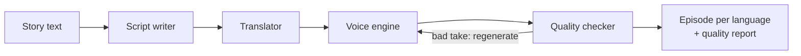

# Multilingual Audio Drama Generator

Turns a short story into a voiced audio drama in several Indian languages, and checks its own output for bad audio.

Give it a story in English or Hindi. It splits the story into a script with a narrator and characters, tags each line with an emotion, gives every character a fixed voice, translates the script, and produces one episode per language. A quality checker then transcribes every clip back to text, finds bad takes, and regenerates them.

Built with [Sarvam AI](https://www.sarvam.ai/) APIs: the `sarvam-105b` chat model, Bulbul v3 text-to-speech, and Saaras v4 speech-to-text.

## Listen

One story, "The Last Local", in four languages. Each character has the same voice in all four.

| Language | Episode | Length |
|---|---|---|
| English | [the_last_local_en-IN.wav](samples/the_last_local_en-IN.wav) | 1m 40s |
| Hindi | [the_last_local_hi-IN.wav](samples/the_last_local_hi-IN.wav) | 1m 57s |
| Tamil | [the_last_local_ta-IN.wav](samples/the_last_local_ta-IN.wav) | 2m 25s |
| Bengali | [the_last_local_bn-IN.wav](samples/the_last_local_bn-IN.wav) | 2m 27s |

A bad take the quality checker caught, and its replacement (same line, same settings):
[first take, 6.1 s](samples/hindi_line8_first_take.wav) and [kept take, 4.2 s](samples/hindi_line8_kept_take.wav).

A three-episode Hindi series, "हवेली का राज़" (The Haveli's Secret), with six characters who keep their voices across episodes:
[episode 1](samples/haveli_ep01_hi-IN.wav), [episode 2](samples/haveli_ep02_hi-IN.wav), [episode 3](samples/haveli_ep03_hi-IN.wav).

The same three episodes with a background score generated by Stable Audio 3, which drops under the voices whenever someone speaks:
[episode 1](samples/haveli_ep01_hi-IN_music.wav), [episode 2](samples/haveli_ep02_hi-IN_music.wav), [episode 3](samples/haveli_ep03_hi-IN_music.wav).

## How it works



| Stage | File | What it does |
|---|---|---|
| Script writer | [script_writer.py](script_writer.py) | Code splits the story into dialogue (inside quotation marks) and narration. The LLM then labels each segment with a speaker and an emotion, and marks bare speech tags ("he said") to drop. |
| Translator | [translator.py](translator.py) | The LLM translates the whole script with the character list in view. Code checks that no line is missing and that each line is written in the target language's script. |
| Voice engine | [tts_engine.py](tts_engine.py) | Assigns one Bulbul voice per character, maps each emotion to a pace and expressiveness setting, generates one clip per line, and joins them with pauses. |
| Quality checker | [quality_check.py](quality_check.py) | Transcribes each clip, scores it against the script, measures speaking speed, regenerates failing lines, and keeps the best take. |
| Pipeline and UI | [make_drama.py](make_drama.py), [app.py](app.py) | One command or one web page to run all stages. |
| Series | [make_series.py](make_series.py) | Runs a folder of episodes in order and keeps a series bible: every character's name, gender, description and voice, fixed the first time they speak. |
| Background music (optional) | [background_music.py](background_music.py), [music_worker.py](music_worker.py) | The LLM reads the episode and writes a short prompt for a music model. Stable Audio 3 Small-Music generates the score on the CPU, and code mixes it under the voices using the line timings. The dry `episode.wav` is kept; the mix is a separate file. |

## Design decisions

These came from trying the obvious approach first and measuring where it failed.

**The LLM labels the script; it does not write it.** The first version asked the LLM to rewrite the story as a script. It dropped sentences or gave narration to characters in most runs, and retries with error feedback did not fix it. Now plain code does the splitting, so no words can be lost, and the LLM has the smallest possible job. After the change, 4 of 4 test runs passed validation on the first attempt.

**Translation uses the LLM, not the translation API.** Sarvam's Mayura translation API works one line at a time, without knowing who is speaking to whom. On this story it produced wrong grammatical genders, heavy English mixing ("एक damp kurta पहने हुए एक old man"), and turned the local train into a "local bus". Giving the chat model the full scene and the character list fixed gender agreement and the level of respect between characters.

**The quality check uses character error rate and speaking speed.** Word error rate over-counts in Indian languages: Tamil scored 12.3% mostly from spacing differences such as "சர்ச்கேட்ல" against "சர்ச் கேட்ல". Pass or fail therefore uses character error rate with spaces removed. Speaking speed was added after a listener reported a "breaking" voice on two Hindi lines that transcribed perfectly: the words were right, but the take was slow with long pauses.

**A series keeps one cast.** Audio series run for many episodes, and a listener notices at once if a character sounds different in episode 5. Each episode's script writer is told which characters already exist and must reuse their exact names; a new name that looks like a variant of an existing one ("राठौर" for "इंस्पेक्टर राठौर") is rejected and sent back. New characters get a voice no one in the series has yet. The variant check is deliberately strict, because Hindi kinship words are short and close: "दादी" (grandmother) and "दादाजी" (grandfather) are different people, and an earlier, looser version merged them.

**Speed is compared within narration and within dialogue, never across.** The narrator reads quickly; characters act and speak more slowly. A single episode-wide speed baseline flagged 6 of 23 good English dialogue lines as "slow". Narration and dialogue now have separate baselines, speed is measured over the voiced part of the clip only, and lines under 15 letters ("Buyers?") are not speed-checked at all.

**Long clips are transcribed in pieces.** Sarvam's speech-to-text accepts at most 30 seconds, and the opening narration ran past that in Marathi. Clips over 28 seconds are cut at the quietest point near the limit, so the cut falls between words, and the transcripts are joined.

**Music drops under speech using the timings the pipeline already has.** Stitching an episode records when every line starts and how long it lasts, so the mixer knows exactly when someone is talking without analysing the audio. The music sits 12 dB below the voices in the intro, outro and long pauses, and 24 dB below while a line is spoken. It starts dipping 0.3 s before each line and recovers over 0.8 s, so the short pauses between lines do not make it pump up and down. The first mix used 8 dB and 20 dB, and a listener found it a little too loud.

**Music instruments are chosen for the mood, not the setting.** The first prompt rule said "match the story's setting", so for a haveli mystery the LLM asked for sitar, sarod and tabla. The listener's verdict: the instruments did not fit the mood. A melodic lead also competes with the dialogue. The rule now picks instruments by mood first (dark pads, low strings, sparse piano for suspense) and allows Indian instruments only as quiet texture, such as a tanpura drone. All three episodes then got prompts in the same family, so the series sounds consistent. Code also rejects any prompt that mentions vocals or singing, even "no vocals". This is a precaution, not a measured problem: a text-to-music model sees the word "vocals" either way.

**The music model runs in the optimised CPU build.** The PyTorch version of Stable Audio 3 Small needs about 4.5 GB of RAM for a 2-minute track. On the 6 GB laptop this was built on, Windows swapped to disk for most of the run, and one track took about 40 minutes. The same model in Stability's TFLite build, with 8-bit weights, made a track in about 8 minutes. It runs as a separate process in its own environment, so the main project does not need PyTorch.

**Text-to-speech is random, so takes are checked, not trusted.** The same line with the same settings took 3.3 seconds in one take and 6.1 seconds, with long pauses, in another. Changing the expressiveness setting or the voice did not help. Generating again and keeping the best take did.

## Results

Measured on the one sample story in all 11 supported languages: 16 lines per language, 176 clips in total.

**Single story, "The Last Local", English source:**

| Language | Failing clips, first take | Failing after retries | Word error rate | Character error rate |
|---|---|---|---|---|
| English | 0 | 0 | 3.2% | 1.1% |
| Hindi | 1 | 0 | 3.3% | 0.8% |
| Bengali | 0 | 0 | 4.3% | 1.1% |
| Tamil | 0 | 0 | 12.3% | 2.7% |
| Telugu | 0 | 0 | 9.8% | 1.3% |
| Marathi | 0 | 0 | 2.4% | 0.5% |
| Gujarati | 0 | 0 | 0.8% | 0.7% |
| Kannada | 0 | 0 | 11.2% | 0.9% |
| Malayalam | 0 | 0 | 6.6% | 1.4% |
| Punjabi | 0 | 0 | 3.7% | 1.7% |
| Odia | 0 | 0 | 10.9% | 1.6% |

**Three-episode series, "हवेली का राज़", Hindi source, 63 lines per language:**

| Episode | Language | Failing clips, first take | Failing after retries | Character error rate, before → after |
|---|---|---|---|---|
| 1 | Hindi | 1 | 0 | 1.1% → 1.1% |
| 1 | English | 3 | 0 | 4.4% → 1.5% |
| 2 | Hindi | 0 | 0 | 1.2% |
| 2 | English | 0 | 0 | 1.4% |
| 3 | Hindi | 1 | 0 | 1.4% → 0.8% |
| 3 | English | 1 | 0 | 1.6% |

Across 302 clips the checker flagged 7 and fixed all 7 by regenerating. Two were garbled words, both in English episode 1: "Ananya hugged her." was heard as "Ananya had." and "Vikram said." as "Vikram sir." Regenerated, both transcribed correctly. The other five were slow, halting takes. All six characters kept the same voice across all three episodes and both languages.

Two stories is a small sample, so read these as a working demonstration, not a benchmark.

The error rates measure the text-to-speech and speech-to-text models together. Some of the remaining error is the transcriber writing "30" where the script says "thirty".

## What didn't work

**Automatic translation checking.** [translation_check.py](translation_check.py) tried to measure translation quality without a native speaker. Sarvam's translation API (Mayura) translated each line back into the source language, chrF scored how close it came to the original, and the chat model judged each line as ok, minor or wrong. It was run on Hindi, Tamil, Bengali and Telugu, and on the English version of the Hindi series.

- **First version (the judge saw the back-translation):** it flagged many lines as wrong. I checked 8 of them by hand in Hindi, Bengali and English, and 7 were false alarms. The translation was correct; the back-translation was wrong, and the judge blamed the translation. For example, Bengali "ত্রিশ বছর" (thirty years) came back as "three years", and "Vikram shrugged" came back as "turned his face away".
- **Second version (the judge compared original and translation directly):** it passed every line, including the one real defect found by hand. In English episode 1, line 7, the translator added a stray "He said," at the end of a narration line. That defect is left in place.
- **Why neither works:** the judge is the same model family that did the translating, so it partly grades its own work, and there is no human-labelled data to tune it against. The script is kept as a record of the attempt. Its scores are not used as a quality claim anywhere.

Translation quality therefore remains unmeasured. Measuring it properly needs native-speaker review of a sample of lines.

**One speed baseline for the whole episode.** An early version of the quality checker compared every line's speed with the episode's overall median. Because the narrator reads faster than the characters act, it flagged 6 of 23 good English dialogue lines as "slow". See the design decisions above for the fix, and the limitations below for what timing still cannot catch.

## Cost

A rough estimate from the Hindi series run (3 episodes in Hindi and English, 11.1 finished minutes), at Sarvam's pay-as-you-go prices as listed in November 2026: text-to-speech ₹3 per 1,000 characters, speech-to-text ₹0.49 per minute, LLM ₹15 / ₹60 per million input / output tokens.

| Stage | Usage | Cost | Per finished minute |
|---|---|---|---|
| Text-to-speech, including 23 retakes | 10,160 characters, 149 clips | ₹30.5 | ₹2.7 |
| Speech-to-text, quality check | 11.4 minutes of audio | ₹5.6 | ₹0.5 |
| LLM, script and translation | about 25,000 tokens (estimated, not logged) | under ₹1 | about ₹0.1 |
| **Total** | | **about ₹37** | **about ₹3.3** |

Background music adds no API cost: Stable Audio 3 Small runs on the local CPU. It took about 8 minutes per episode on a 4-thread laptop (about 6 of them in the model's 8 sampling steps), plus a one-time model download of 1.2 GB.

Text-to-speech is most of the cost. The quality check adds about 15%. The retake count is inflated: episode 1 was checked under an earlier, stricter speed rule that flagged good lines, and the current rules would retake fewer. Token counts are estimated from text length because the pipeline does not log them. Time was not measured.

## Limitations

- **Emotion is approximated.** Bulbul v3 has no direct emotion control, so emotion is expressed through pace and an expressiveness setting. A production system for audio series would need a model that can act a line.
- **Translation quality is not measured.** The quality checker compares audio with the translated script, so it finds bad audio, not bad translation. The Tamil and Bengali scripts have not been reviewed by a native reader.
- **Dialogue needs double quotation marks.** A story without them is treated as all narration.
- **Voice genders are inferred from voice names**, because Sarvam's documentation lists the voices without genders.
- **Halting delivery is only partly detectable.** A listener reported two "breaking" Hindi takes. The current speed rules catch one of them; the other has no more pauses than many normal lines, so timing alone cannot single it out. Measuring this properly needs a set of clips labelled by human listeners, to report the checker's precision and recall.
- **Speech-tag handling varies between episodes.** The model dropped no Hindi speech tags ("दादी ने कहा") in episode 1 and five in episode 3, so some episodes narrate them and some don't.
- **Voices are cast by gender only.** Sarvam does not describe its voices' ages, so an elderly grandmother can get a young-sounding voice.
- **Only two stories have been tested end to end**: one English, one Hindi series.
- **One music track per episode.** The score does not change between scenes, and there are no sound effects. Music has been added to the three Hindi Haveli episodes only, and judged by one listener.
- **Stable Audio 3 Small makes at most 120 seconds.** Longer episodes repeat the track with a 2-second crossfade. Haveli episode 2 (126 s with intro and outro) loops once, near 1:58.

## Run it

Requires Python 3.10 or newer and a [Sarvam AI API key](https://dashboard.sarvam.ai). No GPU and no ffmpeg needed.

```
python -m venv venv
venv\Scripts\activate          # macOS/Linux: source venv/bin/activate
pip install -r requirements.txt
copy .env.example .env         # then paste your key into .env
```

Web app:

```
streamlit run app.py
```

Command line:

```
python make_drama.py stories/sample_story.txt --languages hi-IN ta-IN bn-IN --check
```

A series, from a folder with one text file per episode (`ep01.txt`, `ep02.txt`, ...):

```
python make_series.py stories/haveli --languages en-IN --check
```

Output goes to `output/<story name>/<language>/`: `episode.wav`, the per-line clips, `manifest.json` with timings, and `quality_report.json`. Finished work is reused, so adding a language later only generates that language.

Supported languages: English, Hindi, Bengali, Tamil, Telugu, Marathi, Gujarati, Kannada, Malayalam, Punjabi, Odia.

### Background music (optional)

The music model needs its own environment and a free [Hugging Face](https://huggingface.co) account. Accept the license on the [model page](https://huggingface.co/stabilityai/stable-audio-3-small-music), create a read token, then:

```
git clone https://github.com/Stability-AI/stable-audio-3 %USERPROFILE%\stable-audio-3
cd %USERPROFILE%\stable-audio-3\optimized\tflite
install.bat --download sm-music
.venv\Scripts\hf auth login
```

Then, back in this project, for any finished episode folder:

```
python background_music.py output/haveli/ep01/hi-IN
python background_music.py output/haveli/ep01/hi-IN --seed 7   # a different take of the same prompt
```

This writes `episode_with_music.wav` and `music.json` (the prompt, seed and levels) next to `episode.wav`, and the web app shows a second player for it. If the TFLite build is not installed, it falls back to the PyTorch build in `%USERPROFILE%\stable-audio-3\.venv`, which needs about 4.5 GB of free RAM.

Stable Audio 3 is released under the [Stability AI Community License](https://stability.ai/license). Powered by Stability AI.

## Tests

113 offline tests cover the splitting, validation, translation checks, audio stitching, error-rate maths, the retry loop, series casting, the music prompt checks and mixing, and the web app. They replace Sarvam and Stable Audio with fakes, so they need no API key and no music model.

```
python -m unittest discover tests
```
